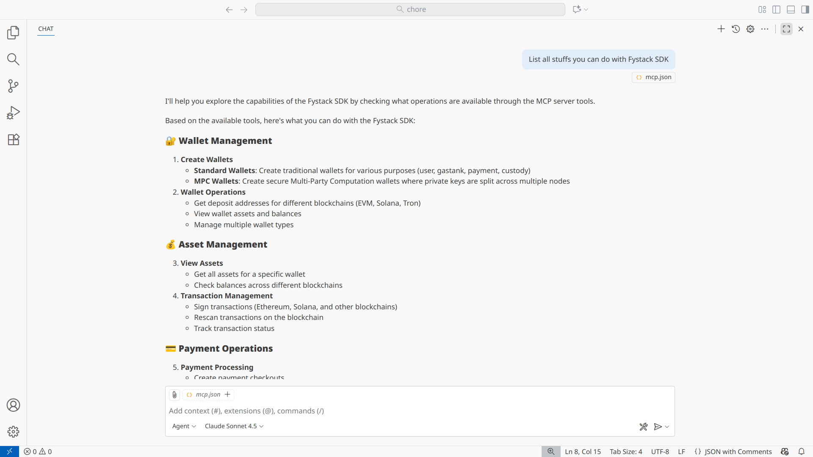
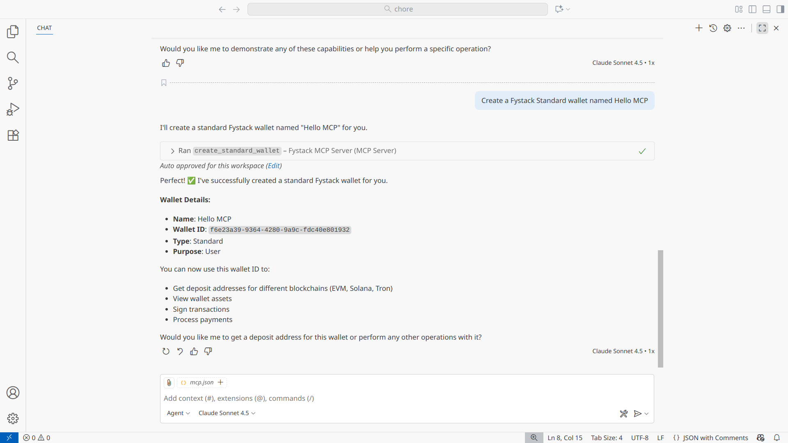

# Fystack SDK MCP Server

A **Model Context Protocol (MCP) Server** that integrates the [Fystack Platform SDK](https://github.com/fystack/platform-sdk), enabling AI agents to securely create wallets, manage assets, sign transactions, and execute blockchain operations.


 

## Features

### Wallet Management
- **Create MPC Wallets**: Generate secure wallets with key shares distributed across MPC nodes
- **Create Standard Wallets**: Generate standard (non-MPC) wallets for various purposes
- **Get Wallet Assets**: Retrieve all assets and balances for any wallet
- **Deposit Addresses**: Get deposit addresses for EVM, Solana, and Tron networks

### Transaction Management
- **Multi-chain Support**: Works with Ethereum, Solana, Tron, and all EVM chains
- **Transaction Rescan**: Reprocess blockchain transactions
- **Secure Operations**: All operations authenticated via API credentials

### Natural Language Interface
- **Conversational Operations**: Describe what you want to do in plain English
- **Smart Parsing**: Automatically extracts parameters from natural language
- **Flexible Commands**: Supports various phrasings and formats

### DeFi Integration
- **Uniswap Trading**: Get price quotes and execute swaps across multiple chains
- **Smart Order Routing**: Automatic best path selection using Uniswap's AlphaRouter
- **Multi-Chain Support**: Trade on Ethereum, Optimism, Polygon, Arbitrum, and Base
- **Native Token Support**: Seamless ETH/MATIC/etc. trading with automatic wrapping

### Future Features
- **Advanced MPC Key Management**: Rotate, recover, or update key shares securely
- **Gas Optimization**: Automatically optimize gas fees for transactions
- **Wallet Recovery**: Recover wallets using MPC key shares
- **Custom Token Support**: Manage custom tokens and NFTs

## Quick Setup

### Prerequisites
- Node.js v18+
- Fystack API credentials ([Get them here](https://app.fystack.io))

### Installation

```bash
# Clone and setup
cd sdk-mcp-server
npm install # or bun install

# Build the project
npm run build
```

### Configuration

The server is configured via environment variables passed through the MCP config file. See `mcp.example.json` for the template.

Required environment variables:
- `FYSTACK_API_KEY`: Your Fystack API key
- `FYSTACK_API_SECRET`: Your Fystack API secret
- `FYSTACK_ENVIRONMENT`: Environment (`local`, `sandbox`, or `production`)

Optional environment variables:
- `SOLANA_RPC_URL`: Custom Solana RPC endpoint
- `ETHEREUM_RPC_URL`: Custom Ethereum RPC endpoint
- `ETHEREUM_CHAIN_ID`: Ethereum chain ID
- `LOG_LEVEL`: Logging level (`debug`, `info`, `warn`, `error`)

### MCP Configuration

Add this to your Claude Desktop config (or other MCP client):

```json
{
  "servers": {
    "Fystack MCP Server": {
      "type": "stdio",
      "command": "npx",
      "args": [
        "-y",
        "~/fystack/mpcium-mcp-server/src/index.ts" // Replace with your path to index.ts
      ],
      "env": {
        "FYSTACK_API_KEY": "YOUR_API_KEY_HERE",
        "FYSTACK_API_SECRET": "YOUR_API_SECRET_HERE",
        "FYSTACK_WORKSPACE_ID": "YOUR_WORKSPACE_ID_HERE",
        "FYSTACK_ENVIRONMENT": "sandbox",
        "LOG_LEVEL": "info"
      }
    }
  }
}
```

### Integration with MCP Client
See all possible MCP Client here: [MCP Clients](https://modelcontextprotocol.io/docs/learn/client-concepts)

1. Locate your MCP Config file
2. Add the server configuration (see MCP Configuration above)
3. Restart the client
4. Client can now interact with Fystack through natural language!

## Architecture

```
┌─────────────────────────────┐
│   Claude / AI Agent         │
│   (MCP Client)              │
└──────────────┬──────────────┘
               │ MCP Protocol (stdio)
┌──────────────▼──────────────┐
│  Fystack MCP Server         │
├─────────────────────────────┤
│ • Tool Definitions          │
│ • Tool Executors            │
│ • Request Handlers          │
└──────────────┬──────────────┘
               │ REST API
┌──────────────▼──────────────┐
│   Fystack Platform SDK      │
└──────────────┬──────────────┘
               │
┌──────────────▼──────────────┐
│  Fystack Backend Services   │
│  • Wallet Management        │
│  • Transaction Processing   │
│  • Asset Management         │
└─────────────────────────────┘
```

## Available Tools

### Natural Language Tool

#### `wallet_operations`
The primary tool that handles all operations through natural language.

**Examples:**
```json
{
  "tool": "wallet_operations",
  "message": "Create an MPC wallet named 'My Secure Wallet'"
}

{
  "tool": "wallet_operations",
  "message": "Get assets for wallet",
  "wallet_id": "550e8400-e29b-41d4-a716-446655440000"
}

{
  "tool": "wallet_operations",
  "message": "Get deposit address for wallet on ethereum",
  "wallet_id": "550e8400-e29b-41d4-a716-446655440000"
}
```

### Direct Tools

#### `create_mpc_wallet`
Creates a new MPC wallet.

```json
{
  "tool": "create_mpc_wallet",
  "name": "My MPC Wallet"
}
```

#### `create_standard_wallet`
Creates a standard wallet.

```json
{
  "tool": "create_standard_wallet",
  "name": "My Standard Wallet",
  "wallet_purpose": "user"
}
```

**Wallet purposes:** `user`, `gastank`, `payment`, `custody`

#### `get_wallet_assets`
Get all assets for a wallet.

```json
{
  "tool": "get_wallet_assets",
  "wallet_id": "550e8400-e29b-41d4-a716-446655440000"
}
```

#### `get_deposit_address`
Get deposit address for a specific blockchain.

```json
{
  "tool": "get_deposit_address",
  "wallet_id": "550e8400-e29b-41d4-a716-446655440000",
  "address_type": "evm"
}
```

**Address types:** `evm`, `solana`, `tron`

#### `rescan_transaction`
Rescan a blockchain transaction.

```json
{
  "tool": "rescan_transaction",
  "tx_hash": "0x123...",
  "network_id": "ethereum"
}
```

### DeFi Tools

#### `uniswap_get_price`
Get a price quote for a Uniswap swap with smart order routing.

```json
{
  "tool": "uniswap_get_price",
  "wallet_id": "550e8400-e29b-41d4-a716-446655440000",
  "chain_id": 1,
  "token_in": "NATIVE",
  "token_out": "0xA0b86991c6218b36c1d19D4a2e9Eb0cE3606eB48",
  "amount_in": "1.0",
  "trade_type": "exactIn"
}
```

**Supported chains:** 1 (Ethereum), 10 (Optimism), 137 (Polygon), 42161 (Arbitrum), 8453 (Base)

#### `uniswap_execute_swap`
Execute a token swap on Uniswap using MPC wallet.

```json
{
  "tool": "uniswap_execute_swap",
  "wallet_id": "550e8400-e29b-41d4-a716-446655440000",
  "chain_id": 1,
  "token_in": "NATIVE",
  "token_out": "0xA0b86991c6218b36c1d19D4a2e9Eb0cE3606eB48",
  "amount_in": "0.1",
  "slippage_tolerance": 0.5,
  "deadline_minutes": 20
}
```

#### `uniswap_suggest_swap`
Get intelligent swap suggestions based on liquidity, fees, and route optimization.

```json
{
  "tool": "uniswap_suggest_swap",
  "wallet_id": "550e8400-e29b-41d4-a716-446655440000",
  "chain_id": 1,
  "token_in": "NATIVE",
  "amount": "1.0"
}
```

**Returns ranked suggestions with:**
- Output amounts for each token
- Price impact analysis
- Gas cost estimates
- Fee comparison
- Route complexity
- AI-generated reasoning

## Usage Examples

### Example 1: Create Wallet and Get Assets

```typescript
// 1. Create MPC wallet
const wallet = await client.call('create_mpc_wallet', {
  name: "Trading Wallet"
});
// Response: { wallet_id: "...", status: "success" }

// 2. Get wallet assets
const assets = await client.call('get_wallet_assets', {
  wallet_id: wallet.wallet_id
});
// Response: { wallet_id: "...", assets: [...], count: 5 }
```

### Example 2: Get Deposit Address

```typescript
// Get Ethereum deposit address
const depositInfo = await client.call('get_deposit_address', {
  wallet_id: wallet.wallet_id,
  address_type: "evm"
});
// Response: { address: "0x...", qr_code: "...", ... }
```

### Example 3: Natural Language Operations

```typescript
// Natural language: Create wallet
await client.call('wallet_operations', {
  message: "Create an MPC wallet named 'My Investment Wallet'"
});

// Natural language: Get assets
await client.call('wallet_operations', {
  message: "Show me the assets in my wallet",
  wallet_id: "550e8400-e29b-41d4-a716-446655440000"
});

// Natural language: Get deposit address
await client.call('wallet_operations', {
  message: "I need the deposit address for Solana",
  wallet_id: "550e8400-e29b-41d4-a716-446655440000"
});
```
---

Built with ❤️ for the Fystack community